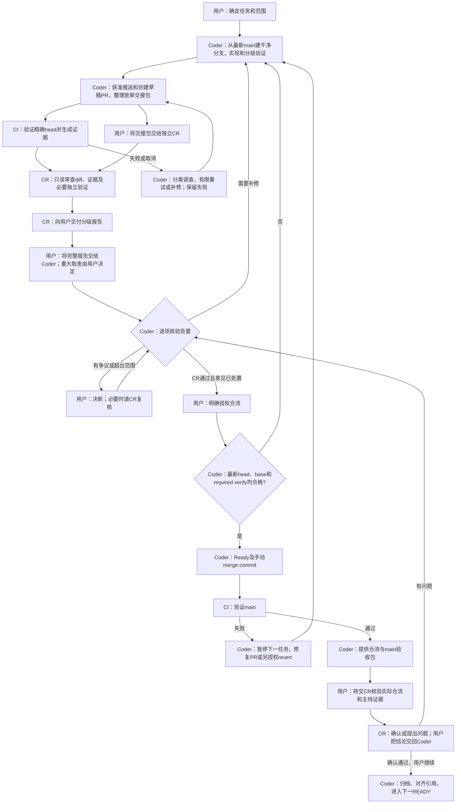

# 日常开发与验收工作流

适用于WF-001～005落地后的日常开发；WEB任务保持原顺序。技术入口见[统一验证](workflow-verification.md)、[CI约定](workflow-ci.md)、[证据复核](workflow-evidence.md)；当轮事实见[收尾归档](review-6a7af2d.md)。不自动开启WF-006/007，不把自动化全绿当产品发布批准。

## 角色、交接与主流程

本项目当前采用两个独立agent：Coder实施，CR只读审查，用户转交材料和决策；不能把Coder的自查当独立CR。两个agent不会自动互相通信，除非用户另行明确授权。CI是自动化证据提供者，不是评审者。下面每个节点都标注责任人。

| 阶段 | 用户实际交给谁、交什么 | 责任与产出 |
|---|---|---|
| 开始 | 给Coder目标、范围和约束 | Coder核对READY、提出验证计划并实施 |
| 首审 | 将Coder首审包交给CR | CR读diff和CI，必要时独立验证，产出阻断/非阻断/未验证报告 |
| 处置 | 将完整CR报告交回Coder | Coder逐项采纳、排除或登记归属；不能自行关闭有争议的问题 |
| 补修复评 | 将Coder补修包交给CR，再把复评报告交回Coder | 新SHA重验，CR确认问题修复及新增差异；循环至通过 |
| 合流 | CR通过后，给Coder具体合流授权 | Coder核对最新检查与base，按约定合流，不自行代替CR放行 |
| 主线核验 | 将Coder合流验收包交给CR，再转回其报告 | CR轻量核对父提交/树/主线CI及证据，不机械重跑全部测试 |
| 下一任务 | 向Coder转交最终结论并指示继续 | Coder按原READY顺序接续 |

Coder负责整理可直接转交的包，不能让用户自行拼装技术材料。首审包至少包含仓库/分支/PR、基线SHA→目标SHA、改动及不可改变边界、实际验证和CI/证据链接、引用旧结果、已知问题/未验证项及CR重点。补修包额外列“问题编号→处置→提交→验证”；合流包包含merge SHA/父提交/树比对、main run/attempt及证据身份。未获推送/建PR授权时交本地包，明确CI尚未运行，完成具体准备后再请求所缺发布授权。不能将未跑CI的本地包写成正式云端验收完成。

用户转交模板：首审“请只读审查此基线至目标SHA及对应CI，报告分级与未验证项”；补修“请复核问题编号及新增差异”；报告回传“请逐项处置，未通过复评不合流”；主线“请核对实际合流和main证据”。CI红时CR可并行快检，绿时仍须独立CR；CR通过后新增代码必须重新验证和交CR审查新增差异。当前Auto-Fix未启用，Coder定位CI失败；Chat规划仅可选，不取代两端职责。

## 开始、范围与分支

1. 用户明确任务即可开工；仅说“继续”时取最前面的READY。无READY、依赖未满足或任务超出已批准范围时，报告阻断/候选，不自行重排。规则、协议、格式、生产依赖、计划外bug等按AGENTS取得相应授权。
2. 复杂跨端任务可选规划：提供带SHA的事实包、相关路径/符号、契约、不可改边界及未决项；规划仅是建议，执行前仍核对代码。简单任务直接实施。WF-006尚未正式试点，不把可选规划变成固定搬运成本。
3. fetch后从最新origin/main建干净LF分支。已有同任务分支可以继续；若main前进，先核对新增差异，不把旧green当最新base通过。任务分支使用feature/*、fix/*、docs/*或maintenance/*，从PR进入主线。
4. 原NTFS脏树只作用户工作区，保留137项差异及用户数据，不全仓规范化/整体暂存。权威执行树的Git状态、原始字节、LFS、源码与oracle必须同源；CRLF旧树的42d…不能复用LF树ff7…的oracle。源码相同且输入/政策无变化的已有证据可以明确引用，不说成新跑。
5. 本地main未检出且可快进时，用预期旧值对齐；若已检出/脏/发生分叉，停止自动移动，不reset覆盖。任务结束后仅安全删除已合并且无独有工作的分支；含未推归档或脏树正在使用的分支改为archive/*保留，不强删，不擅动master或未知分支。

## 本机验证与提交

- 实施前说明风险、范围和所需验证；先完成覆盖前提，再跑定向，最终状态再跑受影响验收。不把用例发现、dry-run、旧结果或截图存在当通过。
- 文档：事实/链接/一致性/diff-check。已列工具：相关契约/语法/真实轻量入口；成功启动路径变动再冒烟。前端：单测/build/资源/相关浏览器，共享页面或恢复等追加默认回归和策略所需gate。Java/规则/共享生产构建：遵循完整门槛与兼容验证。
- `bash tools/verify.sh --base <评审基线SHA> --dry-run --json`只生成计划，不能执行或降级授权。多提交必须给正确base；没有差异时拒绝，显式full只增加计划，不自行授权。
- 本机全量Java/check/FatJAR仍每轮明确批准；云端既有事件的完整验收已获独立预授权，不等于本机批准。相关定向JVM也只经安全入口，单worker、禁止并行JVM，MemAvailable<2GiB不启动。监护中止不记通过；环境失败最多重试一次，先检查自身进程和内存，不结束其他应用。
- 失败保留改动并分类修复；范围外bug先汇报。修完重跑受影响范围，不放宽断言、不自动刷新黄金。通过后选择性提交，写清本轮与引用证据，不夹带用户文件。

## CI选择与触发分支

| 真实差异 | 最低层与追加 | 典型执行 |
|---|---|---|
| 文档/任务索引 | docs | diff-check、输入核对与证据 |
| 明确列出的验证工具/测试配置 | tooling | audit-tests、verify-tests；按具体路径追加ci-tests/资源工具等 |
| 前端页面/功能 | frontend | 前端单测、生产构建/资源、assets/audio、文件重复、默认回归 |
| 共享会话/人物/舞台等路径 | frontend并追加 | 当次oracle生成/核对及gate |
| Java、资源、概率、共享构建、CI驱动/未知路径 | full | 完整20项、Java/check/FatJAR、oracle/gate与真实双向文件交换 |

多路径取最保守层并合并extras；确切计划以当前verify-tiers.json/verify.py的dry-run为准，--paths只能增加触发。tools/ci默认full是有意的，近期约10–16分钟只是观测。普通文档通常更短，冷缓存/runner差异另记。策略未明确覆盖时走full，不为了省一次CI临时降级。

- 当前自动触发：面向main的PR；main或workflow/**的push；显式手动dispatch。普通feature/fix/docs/maintenance分支单独push不会自动运行，必须建PR，或在需要时按授权手动dispatch。
- PR检出精确head，以pull_request.base.sha比较；push以after/before比较。不是合成merge、不是任意HEAD^。手动需要精确base，可显式full用于同SHA复验。
- 同来源分支有取消旧运行的并发策略。新提交到来后旧CI被取消是未完成，不是通过；只采纳最新head结果。不要重复开push/PR运行来凑“稳定次数”。手动更名/新分支、fork、草稿转Ready等事件若未触发运行，先核对实际workflow事件，不假定有CI。
- GitHub临时runner可安装既定依赖；本机不因此有sudo/系统修改授权。缓存命中仍核验内容，不缓存oracle/XML当作新产物。

## CI失败、不可读及补修

| 情况 | 下一步 |
|---|---|
| CI仍排队或运行中 | 等待终态，可先独立只读快检；不把pending当通过，不无故重复触发同SHA |
| 真正代码/断言失败 | 读第一失败和日志，复现、修复、补有意义的回归；新commit重新按差异跑CI |
| 测试前提/竞态错误 | 证明前提、保留严格断言；不得直接扩大超时或容忍错误值 |
| 环境/下载/缺LFS/低内存/缺工具 | 修环境或输入，记录失败，限授权内有限重跑；不把未执行套件记通过 |
| 准备失败/无result/证据损坏/缺产物 | 视为验收未完成或failed；修复证据链，不能只凭某个测试日志放行 |
| CI被取消/旧head完成/分支或base已变 | 不采纳旧绿灯；选择正确最新SHA重新验证 |
| API限流/无token/下载权限不足 | 可用一方页面+完整digest、公开ZIP或保存ZIP+元数据重算；记录来源/新鲜度，不提取token或伪装成认证下载；无法建立身份关联则不验收 |
| Flake怀疑 | 先单跑/重复/反向验证并保存首失败，不凭一次重跑抹掉失败；环境与产品归因必须有证据 |

通过后核对base/head/tested SHA、run/attempt、tier、各套件数量/失败/跳过、日志与ZIP hash、输入/冻结/构建政策、oracle同源和回执身份。下载器需与包内evidence.json逐字段精确复算；rev1/2/3/4按各自规则，不改旧包。policy_skipped（例如full已生成oracle故不另跑oracle-generate）与测试skip不同。JAR若仅记录wrapper hash须直说未下载，外部artifact完整性也不等于验证了全部业务语义。

## 独立CR、合流与主线回归

- Reviewer默认只读diff+CI证据，可要求定向、全套或反向探针。CI绿不替代语义审查；CI红时也可先做独立快检。报告按阻断/非阻断/观察分级。
- 阻断先修，不合并；非阻断逐项核实后采纳、排除或记录归属。更新测试/实现/输入后重跑受影响范围。只补文档则走docs，不能把上轮全量说成新跑；报告歧义要明确更正。
- main保护标准：必须经PR，GitHub Actions来源的verify必需，分支必须最新，管理员不绕过；不允许强推或删除main，不要求单人项目额外批准人数，不启用自动合并。保护状态变更须附可携带截图或设置页面导出及SHA-256，注明时间、来源与独立核验边界；本次见[设置证据](workflow-protection-evidence.json)。具体生效状态看当轮证据；若保存失败/权限不足，仍是人工纪律，绝不能宣称已保护。
- GitHubrequired-check机制不替代本项目严格证据契约：即使平台对neutral/skipped有可接受状态，本项目未执行/缺证据不得据此放行。独立CR仍由用户确认；不配置额外审批人数不是取消独立CR。
- 提交绿且CR通过后，获得本轮合流授权，草稿转Ready，核对最新head、最新base、required verify及未解决问题，再手动merge commit保留小提交。main前进导致过时则同步、重跑、按新差异复审；冲突按实际语义解决并生成新head，再跑受影响验收和复审，不改成squash绕过。
- 合流后真实main push CI必须核对，不能拿PR旧green替代。main失败则暂停下一功能，新修复PR；涉及revert需具体授权，不reset/强推改历史，不擅改保护规则解锁。
- main通过后Coder提供合流验收包，由用户转交独立CR核对，用户再将结论交回Coder；确认通过后对齐本地引用、归档证据/分支，下一READY。后续归档随正常批次同步，不把“归档这次归档”做成无限维护PR。

## 授权和始终未放行的路径

用户可一次明确批准某任务分支范围、推送/草稿PR、该轮必要补修和手动合流；范围变更须重新确认。仓库设置、权限、发布、收费、给其他人发消息等不由普通“继续”自动授权。自动审批若拒绝，不绕过，说明具体操作/原因并请求所缺授权。密码/验证码由用户自行输入，不在聊天收集。

WF-007 Auto-Fix尚未启用：CI失败默认Codex人工定位；用户可另授权独立AI诊断或修复草案。将来试点仍须同SHA三次full+失败注入前置、一次一个受限草案、再CI+独立CR，禁止自动合并/循环自修。WF-006规划也仍是可选试点，不属于每日必经门。

A06/A07/A08、046/049人工浏览器/DPI/辅助技术、音频听审/物理设备/循环接缝、047容量/长局及最终发布批准均不能由自动化关闭。fork及一方认证ZIP等未覆盖项照实保留，真实上线还需单独发布流程与明确批准。

GitHub规则语义参考：[受保护分支](https://docs.github.com/en/repositories/configuring-branches-and-merges-in-your-repository/managing-protected-branches/about-protected-branches)、[必需检查排障](https://docs.github.com/en/pull-requests/how-tos/merge-and-close-pull-requests/troubleshooting-required-status-checks)。
